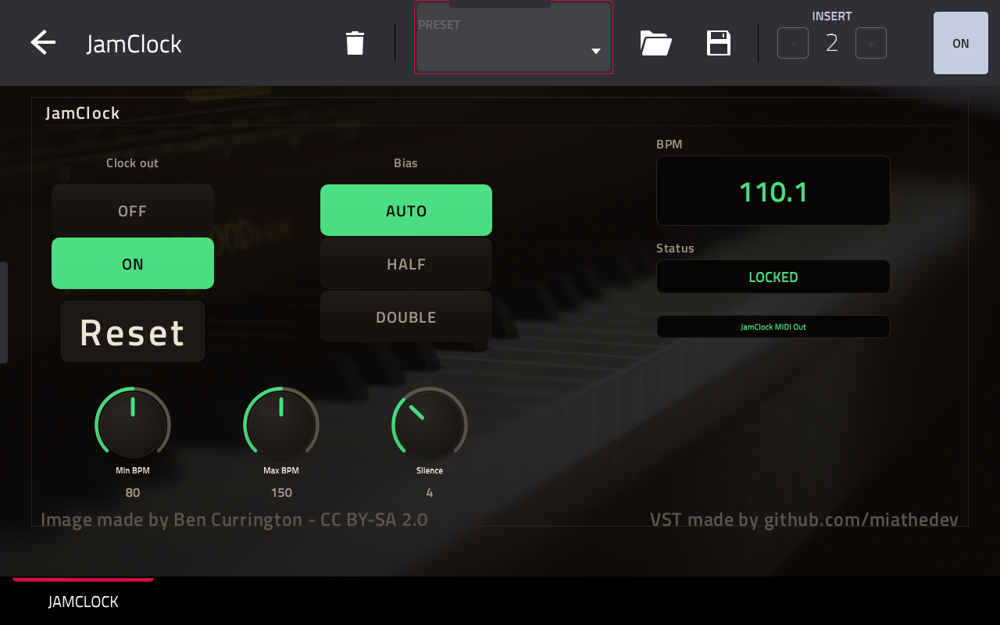
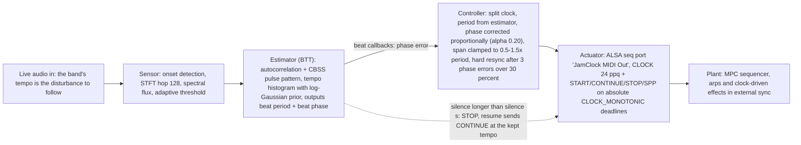

# JamClock

JamClock is a listen-only insert effect for Akai MPC. Put it on an input track carrying your
band's live audio (e.g. Input 3/4): it beat-tracks the signal on a background thread and emits
MIDI Clock (24 ppq) plus Start/Continue/Stop on its own ALSA sequencer port, `JamClock MIDI Out`.
Connect that port to the MPC app's MIDI input and set the MPC to external sync - the sequencer,
arps and clock-driven effects then follow the band in time. The audio passes through
bit-identical. No extra hardware is needed.

```
aconnect "JamClock MIDI Out" "<MPC app>:<MIDI in>"
```



## Requirements

- MPC OS 3.x - Gen1 armv7 (X/Force/Live/One/Key, e.g. MPC X SE) or Gen2 aarch64 (Live III,
  One G2, ...). The binary needs glibc >= 2.35 (MPC OS 3.x ships 2.39, MPC OS 2.x will not
  load it). 44.1 kHz.
- Install: on MPC OS 3.10.1+ the plugin folder from the release zip is listed natively when
  dropped into the `VST2 Plugins` folder. On older 3.x use the root-SSH installer below.

## Quick start (on the MPC)

1. Download the release zip from the Releases page: `JamClock-<version>-mpc-armv7.zip`
   (Gen1) or `JamClock-<version>-mpc-aarch64.zip` (Gen2).
2. Copy it to the MPC and run the bundled installer as root over SSH:
   ```
   scp JamClock-<version>-mpc-armv7.zip root@<mpc-ip>:/tmp/jamclock.zip
   ssh root@<mpc-ip> 'cd /tmp && unzip -o jamclock.zip -d jamclock && cd jamclock/JamClock-2.0.0 && sh install.sh -y'
   ```
   (On MPC OS 3.10.1+ instead: unzip and copy the plugin folder into `VST2 Plugins`.)
3. On the MPC: track 3/4 = audio input, insert JamClock on it, track monitored (thru) so
   `process()` runs.
4. MPC settings: sync = external, MIDI input = the port you connect to.
5. `aconnect "JamClock MIDI Out" "<MPC MIDI in port>"` (see `/proc/asound/seq/clients`).
6. Play. The BPM readout locks, the status goes LOCKED, the MPC follows the band.

Rollback: run `uninstall.sh` from the zip, or delete the plugin folder and its plugin-list
entry (or re-flash the official OS image).

## How it works

- The RT audio callback only memmoves the passthrough (bit-identical) and pushes into a
  lock-free SPSC ring - no malloc/dlopen/ALSA on the audio path. A worker thread
  (SCHED_OTHER, kept off the audio cores) does everything else.
- The worker runs the vendored BTT beat tracker (spectral-flux onsets -> autocorrelation ->
  CBSS pulse-pattern cross-correlation -> tempo histogram with log-Gaussian prior,
  `src/btt/`) and a drift-free split clock, and sends CLOCK 24 ppq / START / CONTINUE /
  STOP / SPP on absolute CLOCK_MONOTONIC deadlines via its own ALSA seq port.
- Lock = valid BTT period + a beat within 2 periods + at least 4 s of audio. First lock
  sends SPP + START. Silence longer than `silence` s sends STOP. The first beat after
  resume sends SPP + CONTINUE at the kept tempo.
- Validated on 1660 real tracks (GiantSteps + GTZAN, `test/eval/`): raw 4% tempo accuracy
  0.72 overall, 0.96 at 130-150 BPM, 0.60 above 150 BPM (details and full table in
  `test/eval/README.md`).

### Control-loop



The RT audio callback only feeds the estimator through the SPSC ring, the worker thread runs sensor, estimator, controller and actuator off the audio cores.

## Parameters (index order = VST index)

| # | key | options/range | default |
|---|-----|---------------|---------|
| 0 | enable | Off, On | On |
| 1 | bias | Auto, Half, Double | Auto |
| 2 | minbpm | 40..120 (int) | **40** |
| 3 | maxbpm | 60..240 (int) | **200** |
| 4 | silence | 1..10 s (int) | 3 |
| 5 | reset | momentary | - |
| 6 | bpm | readout (string, polled) | `--` |
| 7 | status | readout: OFF/SEARCH/LOCKED/STOPPED | - |
| 8 | port | readout: `JamClock MIDI Out` or ALSA error | - |

Q-Links (one tab): enable, bias, minbpm, maxbpm, silence, reset.

Measured tips (`test/eval/`): keep `minbpm` below the slowest tempo you expect (the default
is 40 - with `minbpm` equal to the true tempo, 60 BPM material can flip to 120 BPM). Slow
material (< ~100 BPM) can lock at double tempo: use `bias=Half`, or cap `maxbpm` below 2x
the slowest expected tempo (e.g. `maxbpm=115` for music up to ~115 BPM, raw 4% accuracy on
the <=120 BPM subset goes 0.56 -> 0.81 vs the 200 default).

Chunk-only keys (not in params.json, the chunk is `jclk2` with 8 keys and still reads
`jclk1`): `lookahead_ms` (5-100, default 30), `prior` (0.2-2.0, default 0.625, width/mean
ratio of the log-Gaussian tempo prior), `sil_rms` (1e-6..1e-2, default 1e-4 ~ -80 dBFS hop
RMS, the silence threshold for STOP).

## Build from source

JamClock is built on the `mpc-vst-plugins` VST2 wrapper framework. Check the framework out
next to this repo (sibling directory `../mpc-vst-plugins`, or set
`MPC_VST=/path/to/mpc-vst-plugins`):

```
./build.sh [armv7|aarch64|all]   # Docker cross-build -> vst/build/
./test.sh                        # offline host test under ASan/UBSan
./test/run_ab.sh                 # offline real-time A/B harness
./render_ui.sh                   # render the UI skin -> vst/build/preview/
```

Release zips are produced by CI: `.github/workflows/vst-release.yml` calls the shared
draft-release workflow of
[open-mpc/mpc-vst-plugins](https://github.com/open-mpc/mpc-vst-plugins) (SHA-pinned in both
`uses:` and `tools_ref`). Actions -> "VST release (draft)" -> Run workflow with `version` and
optionally `dry_run`. See
[docs/RELEASING.md](https://github.com/open-mpc/mpc-vst-plugins/blob/main/docs/RELEASING.md).

## Testing

- `./test.sh` - ASan/UBSan host test incl. preset-chunk round-trip (PASSED).
- `./test/run_ab.sh` - real-time A/B harness. Locks click tempos 60/90/120/174 BPM within
  +-0.11 BPM in ~4 s, no octave jumps on sweeps, bit-identical passthrough.
- `test/eval/run_eval.sh <name>` - offline evaluation on 1660 real audio tracks
  (GiantSteps + GTZAN, datasets fetched by `test/eval/prep_datasets.py` into gitignored
  `test/datasets/`). Numbers: `test/eval/README.md`.

## License & third-party sources

JamClock itself is GPL-3.0-or-later. See [LICENSE](LICENSE).

- Beat-and-Tempo-Tracking (BTT), vendored in `src/btt/`:
  <https://github.com/michaelkrzyzaniak/Beat-and-Tempo-Tracking> at commit `c039090`, MIT
  License (`src/btt/BTT_LICENSE`, local patches documented in `src/btt/VENDORED.md`).
- Split-clock architecture after [AudioClock](https://github.com/DVA-4/AudioClock),
  algorithms per Percival & Tzanetakis, IEEE/ACM TASLP 22(12), 2014,
  <https://doi.org/10.1109/TASLP.2014.2304542>, and Davies & Plumbley, IEEE TASLP 15(1),
  2007, <https://doi.org/10.1109/TASLP.2006.883857>.
- Skin background photo: "Piano" by Ben Currington, aka
  [baconisavegetable](https://www.flickr.com/photos/baconisavegetable/14252616286/), licensed
  under [CC BY-SA 2.0](https://creativecommons.org/licenses/by-sa/2.0/). The same credit is
  shown in the plugin UI (bottom of the JAMCLOCK tab, see `vst/layout.conf`) next to
  "VST made by github.com/miathedev".
